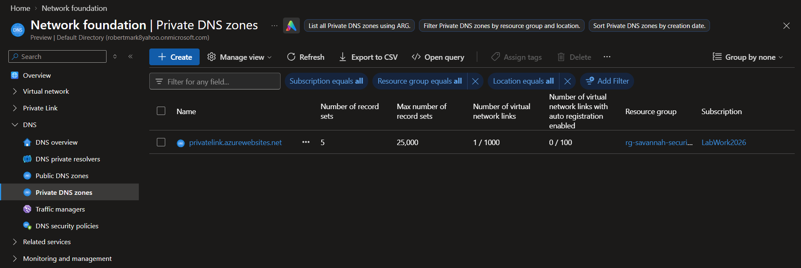
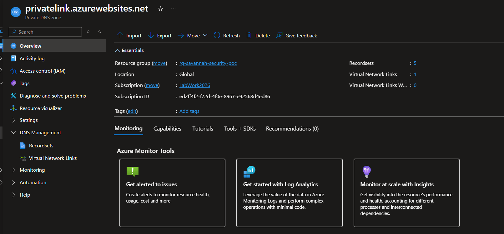
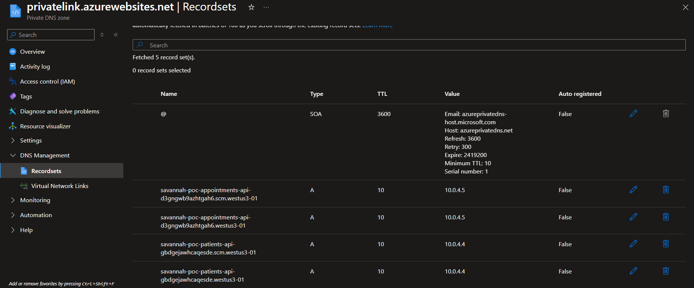
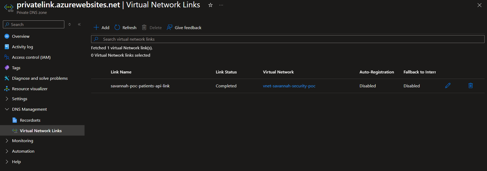
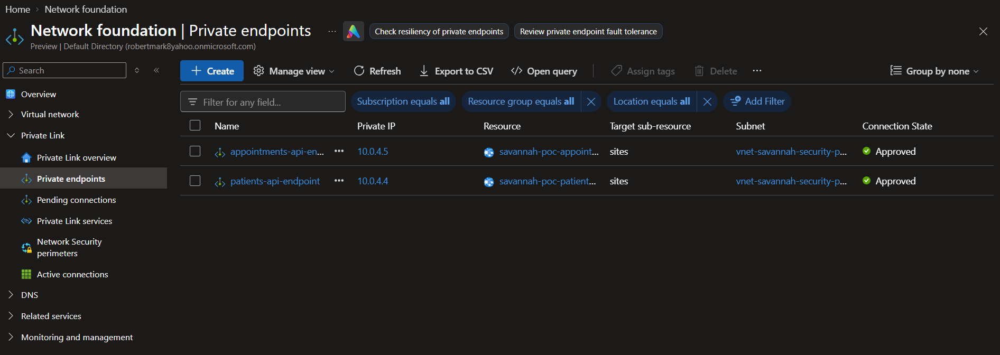

# Azure Private DNS Configuration

## 1. Overview

Azure Private DNS provides hostname resolution for the backend App Services through their Private Endpoints.

The `privatelink.azurewebsites.net` DNS zone enables resources within the Virtual Network to resolve the backend application hostnames to their respective private IP addresses.

Azure takes care of the following configuration settings during the initial deployment. The following are screenshots of the confirmations:

---

## 2. Private DNS Zone

| Property | Configuration |
|---|---|
| DNS Zone Name | `privatelink.azurewebsites.net` |
| Resource Group | `rg-savannah-security-poc` |
| Virtual Network | `vnet-savannah-security-poc` |
| Auto-registration | Disabled |

---

## 3. Private Endpoint DNS Integration

Both backend App Services are integrated with the Private DNS zone.

| Property | Patient Records API | Appointments API |
|---|---|---|
| Private Endpoint | `patients-api-endpoint` | `appointments-api-endpoint` |
| Private IP | `10.0.4.4` | `10.0.4.5` |
| DNS Zone Group | `default` | `default` |
| Private DNS Zone | `privatelink.azurewebsites.net` | `privatelink.azurewebsites.net` |
| DNS Integration | Configured | Configured |

---

## 4. Virtual Network Link

The Private DNS zone is linked to the project Virtual Network.

| Property | Configuration |
|---|---|
| Link Name | `savannah-poc-patients-api-link` |
| Virtual Network | `vnet-savannah-security-poc` |
| Link Status | Completed |
| Auto-registration | Disabled |

---

## 5. Private Endpoint Configuration Confirmation

Both backend App Services have successfully provisioned Private Endpoints within `vnet-savannah-security-poc`.

The following configurations have been confirmed in Azure:

| Property | Patient Records API | Appointments API |
|---|---|---|
| Private Link Resource | `savannah-poc-patients-api` | `savannah-poc-appointments-api` |
| Private IP Address | `10.0.4.4` | `10.0.4.5` |
| Subnet | `subnet-private-endpoints` | `subnet-private-endpoints` |
| Connection Status | Approved | Approved |

Both Private Endpoints have been successfully created, their connection requests are approved. DNS integration with **privatelink.azurewebsites.net** is also configured for both endpoints.

---

## 6. Configuration Verification

The following configurations have been confirmed in Azure:

- Private DNS zone created.
- Patient Records Private Endpoint integrated with the DNS zone.
- Appointments Private Endpoint integrated with the DNS zone.
- Virtual Network link configured.
- DNS hostname resolution tested. [pending]
- APIM backend connectivity validated. [pending]

---

## 7. Implementation Notes

The Private DNS configuration provides the foundation for APIM to access the backend applications using their standard App Service hostnames while resolving to private endpoint addresses.

---