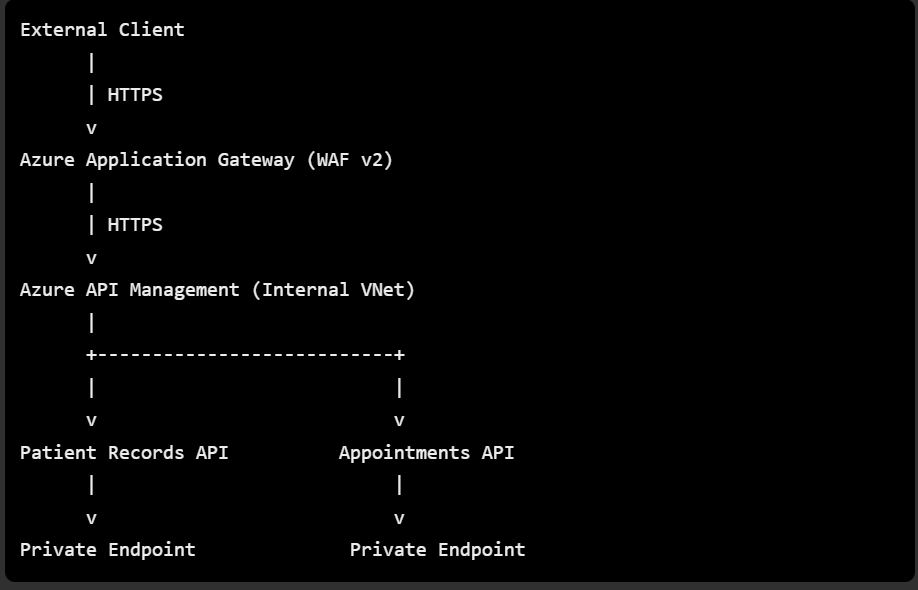

# Azure Resource Connections

## Overview

This folder records the network and service connections between the Azure resources deployed as part of the API Security Gateway and WAF Lab.

Each connection has a dedicated Markdown file covering its architecture, configuration, security controls, and connectivity testing. This provides a structured record of how resources communicate and how their connections are secured.

---

## Architecture Overview

The intended request flow is:

External API traffic enters through Azure Application Gateway WAF, which forwards requests to API Management. APIM routes requests to the appropriate backend API through private connectivity.

Microsoft Sentinel and Log Analytics provide centralized monitoring and security visibility. They are supporting services rather than part of the application request path.

---

## Azure Resource Inventory

| Resource | Name | Network/Location |
|-----|-----|-----|
| Resource Group | rg-savannah-security-poc | West US 3 |
| Virtual Network | VNet-savannah-security-poc | 10.0.0.0/16 |
| Application Gateway | appgw-savannah-security-poc | subnet-wafgw |
| API Management | apimgmt-savannah-security-poc | subnet-apimgmt |
| Patients Service | savannah-poc-patients-api | App Service |
| Appointments Service | savannah-poc-appointments-api | App Service |
| Private Endpoint Patients API | patients-api-endpoint | subnet-private-endpoints |
| Private Endpoint Appointments API | appointments-api-endpoint | subnet-private-endpoints |
| Private DNS Zone | privatelink.azurewebsites.net | Private DNS |
| Log Analytics Workspace | TBD | Monitoring |
| Microsoft Sentinel | TBD | Monitoring |

---

## Connection Documentation

Each connection is documented and implemented independently.

| Connection | Documentation |
|---|---|
| Application Gateway to API Management | `application-gateway_api-mgmt.md` |
| API Management to Private Enpoints | `api-mgmt_private-endpoints.md` |
| Private DNS Configuration | `private-dns-configuration.md` |
| Monitoring and Sentinel Integration | `monitoring-log-analytics-sentinel.md` |

Each document records the connection objective, architecture, resource configurations, connection settings, connectivity tests, and supporting evidence.

**Implementation approach:** Configure, test, and document each connection before proceeding to the next. Statuses will be updated to reflect actual implementation progress.

---

