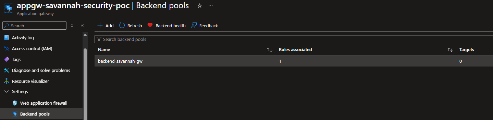
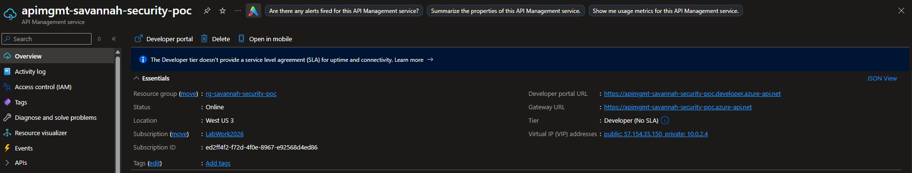
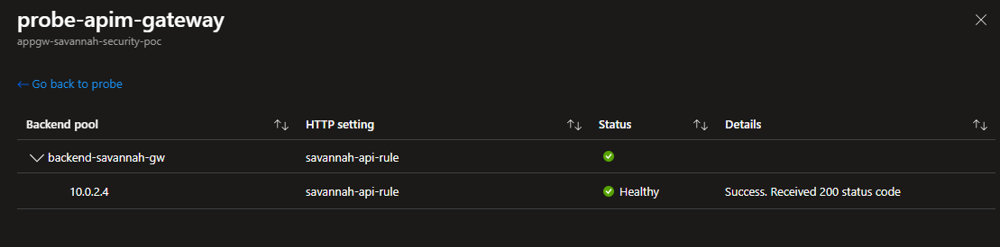
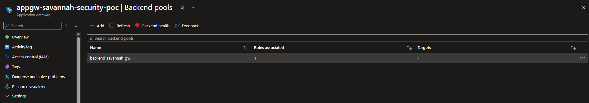
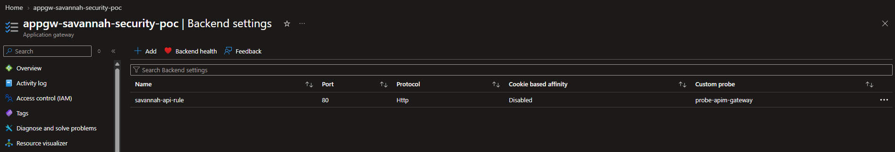
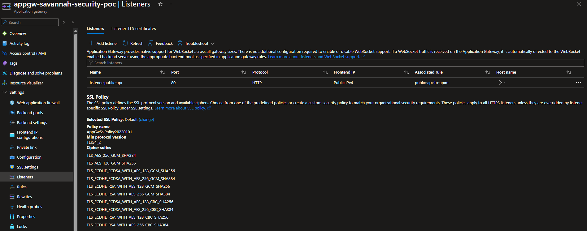
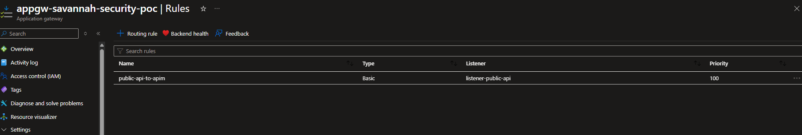
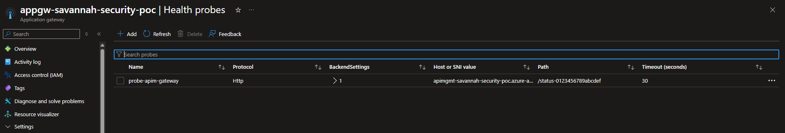
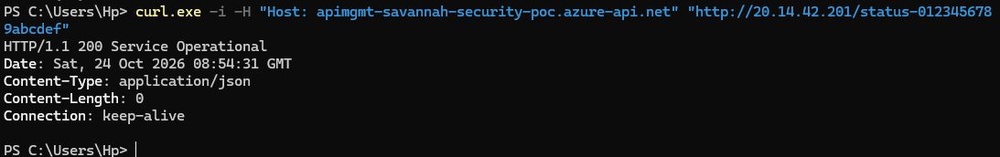

# Application Gateway to API Management Service

## 1. Objective

Establish secure communication between Azure Application Gateway WAF v2 and Azure API Management (APIM).

Application Gateway acts as the internet-facing entry point, inspecting incoming HTTP(S) requests through its Web Application Firewall before forwarding legitimate API traffic to APIM.

APIM handles API routing and enforcement of API-level security policies before requests reach the backend services.

## 2. Configuration

### Application Gateway: Set up the backend pool to API Management Service

- On the Application Gateway resource, click on *Backend Pools* under *Settings*.
- You should find the backend pool created duirng the deployment i.e. *backend-savannah-gw*. Click to open it.

- Navigate to the API Management Service to get it's IP address. It is needed for this configuration. 
- Once established, proceed with the configuration below:

| Property | Value |
|-----|-----|
| Add backend pool without targets | No |
| Sever selection algorithm | Round Robin |
| Backend Targets | 10.0.2.4 (My API Management IP address) |

## 3. Connectivity Testing

To confirm that the APP Gateway and API Management can communicate, navigate to *Application Gateway → Settings → Health probes → Add*

| Property | Configuration |
|---|---|
| Protocol | HTTP |
| Pick host name from backlend settings | No |
| Host | <apimhmt servicename>.azure-api.net (apimgmt-savannah-security-poc.azure-api.net) |
| Pick port from backend settings | No |
| Port | 80 |
| Path | /status-0123456789abcdef |
| Interval (seconds) | 30 |
| Timeout (seconds) | 30 |
| Unhealthy threshold | 3 |
| Use probe matching conditions Yes |
| HTTP response status code match | 200-399 |
| Backend settings | savannah-api-rule |

-  Check the box: I want to test the backend health before adding the health probe. Then click **Test**.

- You should see the **Healthy Result** below:

This establishes connectivity between Application Gateway and APIM.

## 4. Evidences

### Backend Pool 

### Backend Settings

## Listeners

### Rules

### Health Probes

### Externla-to-APIM Request Forwarding Validation

**Outstanding Issues / Notes:**

- External HTTPS and TLS termination are deferred for this lab stage.
- Current Application Gateway to APIM communication uses HTTP.
